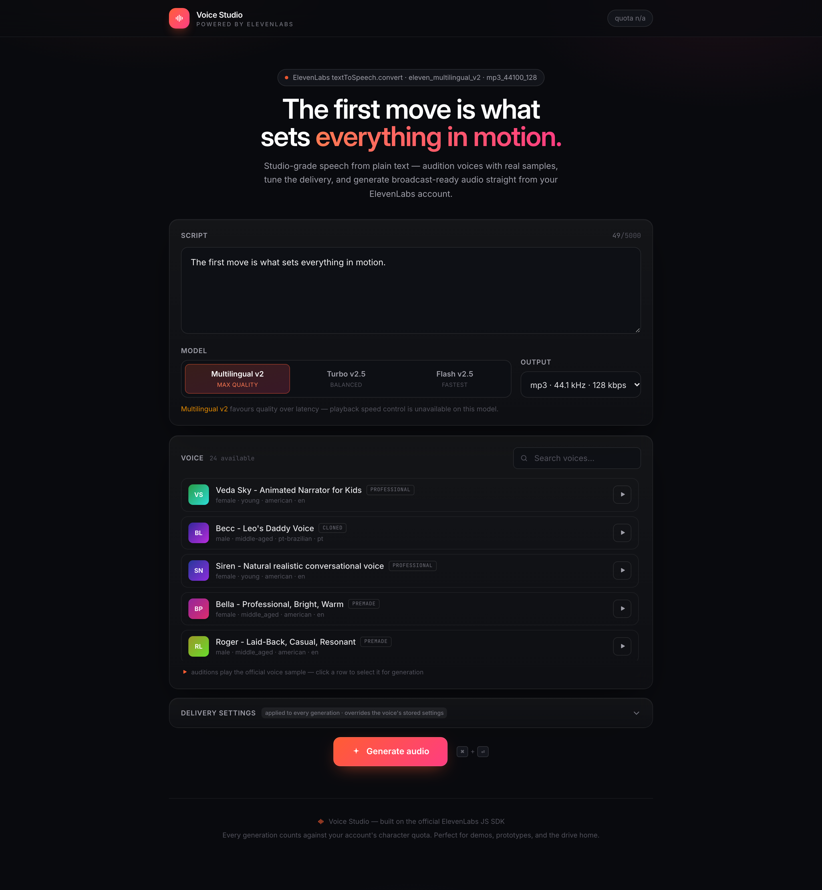

# Voice Studio

A professional text-to-speech web app built around the [ElevenLabs getting-started snippet](https://github.com/elevenlabs/elevenlabs-js) (`textToSpeech.convert`, voice `JBFqnCBsd6RMkjVDRZzb`, model `eleven_multilingual_v2`, format `mp3_44100_128`).

 

## Preview



## Features

- **Studio UI** — dark glass design, animated hero, model as segmented cards, ⌘⏎ shortcut
- **Voice auditioning** — searchable list of your account voices with inline play of each voice's official sample (`previewUrl`)
- **Delivery settings** — stability / similarity / style sliders, speaker-boost toggle, and speed (auto-hidden + dropped server-side for models that don't support it), sent with every request as `voice_settings`, so they always override the voice's stored settings
- **Live waveform** — Web Audio `AnalyserNode` visualizer on the player, bars react to your own generated take
- **Character quota** — tier + usage pill pulled from the account subscription; refreshes after every generation (quietly degrades to "quota n/a" if the key lacks `user_read`)
- **Robust API** — validation of text/model/format/settings, friendly error mapping (quota / auth / permission / rate-limit / upstream), graceful no-key boot, request logging, graceful shutdown
- **Quota errors handled** — a failed generation due to exhausted characters shows a persistent banner with usage numbers, reset date, and a "Manage plan" link, instead of a generic toast

## Project layout

```
server.js          Express API — meta, voices, quota, tts (streams MP3 to the browser)
client/            React 19 + TypeScript + Tailwind 4 SPA (Vite)
└── src/App.tsx    orchestration + hero; components/ holds the rest
dist/              production build output (served by Express)
.env               your ELEVENLABS_API_KEY (see .env.example)
```

## Run

```bash
npm install
cp .env.example .env          # paste your key from elevenlabs.io → Profile → API Keys

npm run dev     # API on :3000 (watch mode) + Vite dev server on :5173 (proxy /api)
npm run build   # bundle the SPA into dist/
npm start       # serve API + built SPA on http://localhost:3000
```

Open http://localhost:3000

## API

| Route | Purpose |
|---|---|
| `GET /api/meta` | models, output formats, settings ranges, snippet defaults |
| `GET /api/health` | liveness probe — 200 when `ELEVENLABS_API_KEY` is set, 503 otherwise |
| `GET /api/voices` | account voices incl. `previewUrl` (audition samples) |
| `GET /api/quota` | tier + character usage from the subscription |
| `POST /api/tts` | text → MP3; accepts `voiceId`, `modelId`, `outputFormat`, `voiceSettings` |

Note: `POST /api/tts` charges your account's characters per generation. Failure responses are JSON `{ error, kind }` where `kind` classifies the problem: `quota`, `auth`, `permission`, `rate_limit`, `validation`, `network`, `upstream`, or `unknown`.
